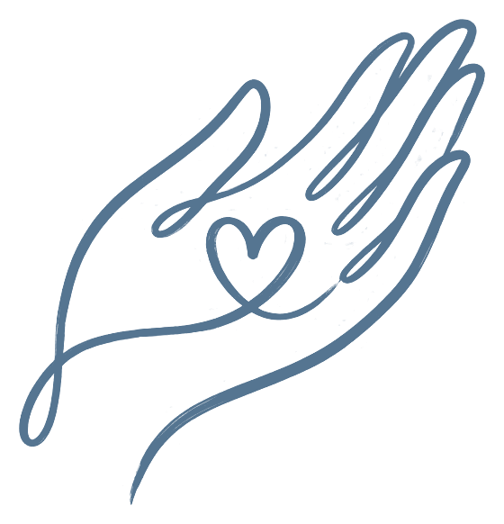
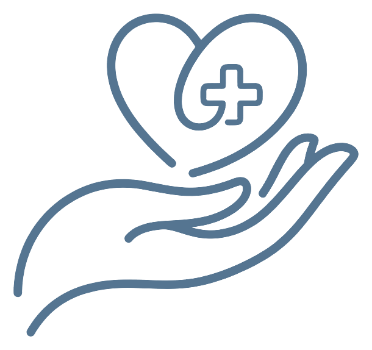
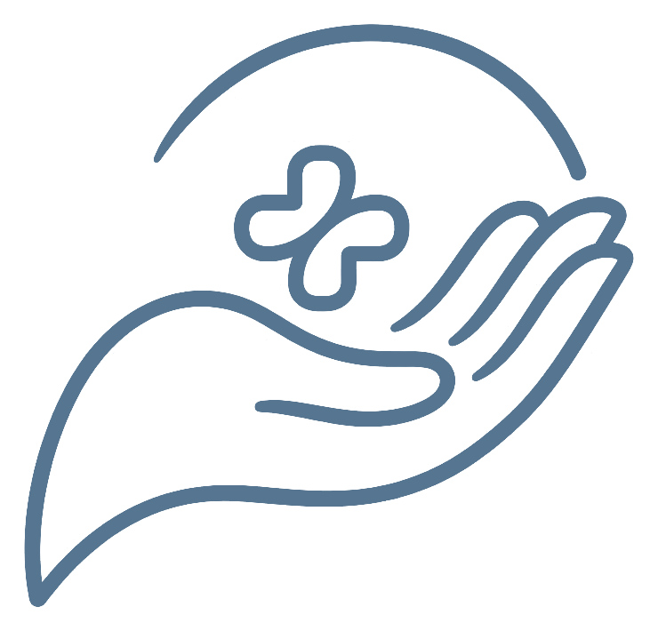
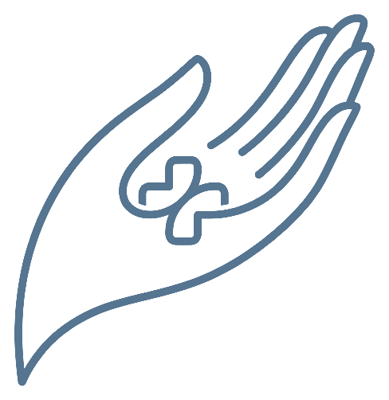

## Domeniul .ro

Se cumpără pe numele dumneavoastră, de la unul dintre:

- **Host-Age**: host-age.ro
- **Hostico**: hostico.ro

Este nevoie doar de domeniu, fără pachet de găzduire.

## Găzduirea

- Site-ul este găzduit gratuit pe **Cloudflare**, una dintre cele mai mari rețele de internet din lume.
- Se încarcă rapid, are conexiune securizată și protecție împotriva atacurilor.
- Nu există server de întreținut și nici actualizări de făcut.
- Cererile de programare ajung direct pe email și nu rămân stocate pe site.

## Adăugarea de pagini și conținut

- Aveți un **panou de administrare propriu, în limba română**, accesibil din browser.
- Puteți adăuga și modifica:
  - afecțiuni, servicii și articole;
  - întrebări frecvente;
  - pagini noi și poze.
- Apăsați **„Publică”**, iar site-ul se actualizează singur în 1–2 minute.
- Nu sunt necesare cunoștințe tehnice.

## Apariția în Google (SEO)

- Fiecare pagină nouă este anunțată automat către Google.
- Pentru fiecare pagină puteți stabili titlul și descrierea care apar în rezultatele căutării.
- Site-ul îi arată lui Google că este vorba despre un medic, despre afecțiuni, tratamente și întrebări frecvente.
- Site-ul este rapid și adaptat pentru telefon, iar ambele contează la poziția în Google.

## Propuneri de logo

1. 
2. 
3. 
4. 
5. 
6. 

# Date necesare

## Date de contact și clinică

1. Numele clinicii (sau al cabinetului, dacă aveți cabinet propriu)
2. Adresa completă: strada și numărul, orașul, județul, codul poștal
3. Telefonul pentru programări
4. Adresa de email afișată pe site
5. Adresa de email pentru cererile de programare (poate fi aceeași)
6. Programul de consultații: zilele și orele, sau „doar pe bază de programare”
7. Linkul Google Maps al clinicii

## Despre dumneavoastră

1. O fotografie profesională: portret sau bust, lumină naturală, ideal în halat
2. Formarea profesională: facultatea și anii, rezidențiatul (specialitatea și spitalul), cursuri și specializări în chirurgia mâinii
3. Societățile profesionale din care faceți parte
4. Câteva rânduri despre dumneavoastră: parcursul profesional, ce v-a atras spre chirurgia mâinii, cum lucrați cu pacienții (îl redactăm noi)

## Informații pentru pacienți

1. Documentele necesare la consultație
2. Modalitățile de plată
3. Prețul consultației (opțional)
